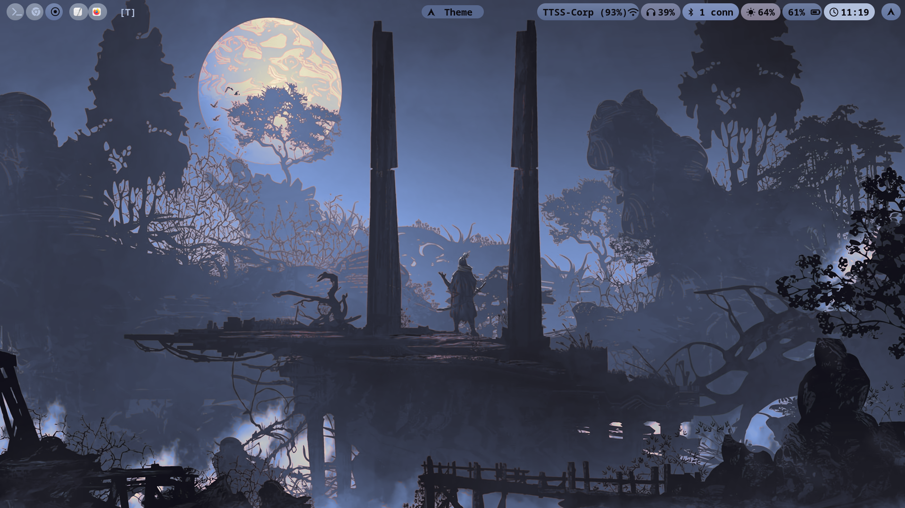
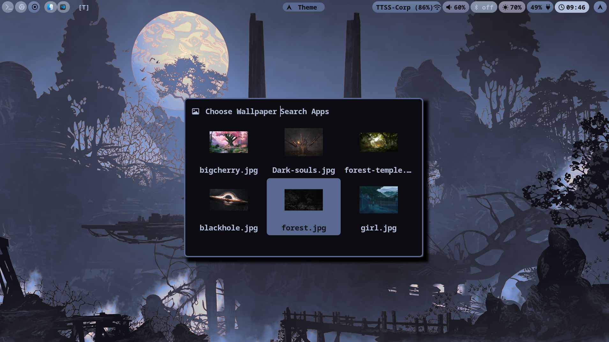
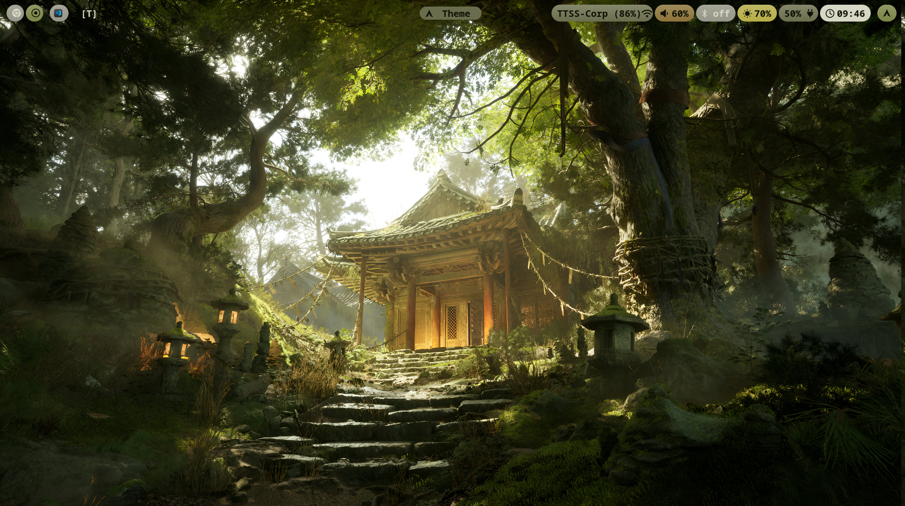

# mango-config
# Custom config files for mangowm




* To use these you either use the one-line command
```bash
curl -s https://raw.githubusercontent.com/cord2134/Dotfiles_Mango/main/install.sh | bash
```
* If you wish to build and also review the config files then:
```bash
git clone https://github.com/cord2134/Dotfiles_Mango.git
cd Dotfiles_Mango
chmod +x install.sh
./install.sh
```

* This repo was initially cloned from DreamMaoMao mango config.
* To clone and use that config you can use the command:
```bash
 git clone https://github.com/DreamMaoMao/mango-config.git ~/.config/mango
 ```

